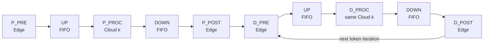
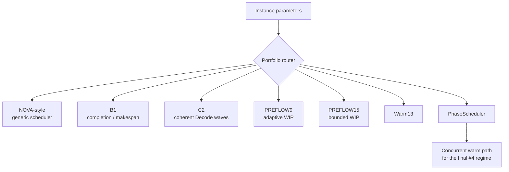
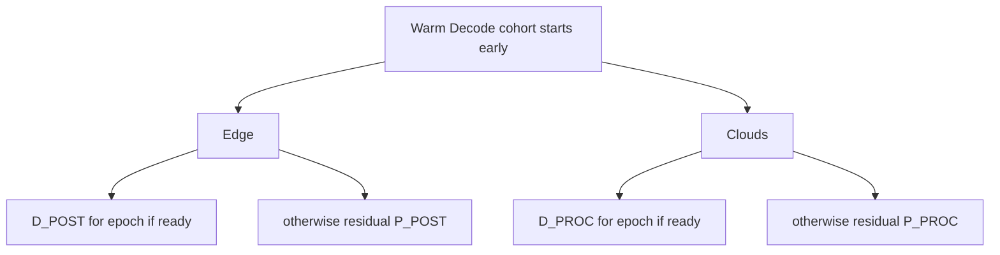
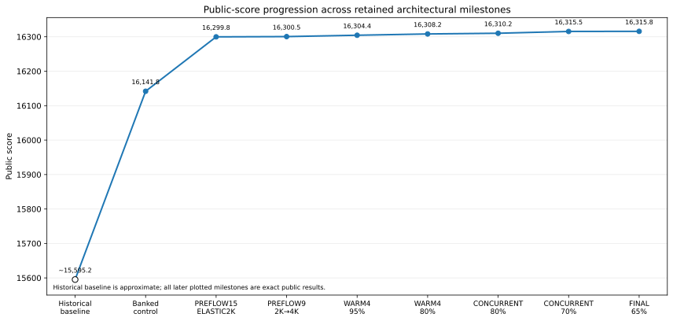
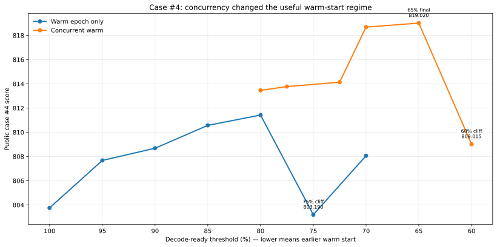

<div align="center">

# ICPC Huawei 2026 — Edge–Cloud Collaborative Scheduling

**An evidence-backed engineering case study of an iterative C++ scheduler for Codeforces 2251A.**

[](final/final_submission.cpp)
[](experiments/data/final_public_22_cases.csv)
[](experiments/validate_dataset.py)
[](experiments/DATA_DICTIONARY.md)

[Final submission](final/final_submission.cpp) · [Technical report](report/ICPC_Huawei_2026_Edge_Cloud_Scheduling_Technical_Report.pdf) · [Architecture](docs/architecture/SCHEDULER_ARCHITECTURE.md) · [Experiment ledger](experiments/data/experiment_ledger.csv) · [Optimization journey](docs/journey/01_JOURNEY_OVERVIEW.md)

</div>

---

## At a glance

| Item | Result |
|---|---:|
| **Author / participant** | **Nitin Jaiswal** (`nitinjaiswalnj2001`) |
| **Final 22-case public score** | **16315.7938558663** |
| Gain over earliest exact preserved bank | **+173.9731673617** |
| Historical starting score | **~15595.199** *(approximate)* |
| Final public case #4 | **819.0202365952** |
| Final public case #20 canary | **998.0785092863** |
| Implementation | **C++17** |

> **Scope note:** this repository records the preserved **public-judge** results and the post-contest reconstruction of the engineering process. The older ~15595.199 baseline survives only as a historical working-note value, so it is intentionally marked approximate. Hidden/system-test behavior is not inferred from the public vector.

**Official links:** [Codeforces contest 2251](https://codeforces.com/contest/2251) · [Final standings](https://codeforces.com/contest/2251/standings) · [ICPC/Huawei challenge announcement](https://codeforces.com/blog/entry/155646)

## Why this repository exists

This is not a repository containing only one final contest submission.

It reconstructs the path to that submission: which scheduler control surfaces were tested, which ideas failed, how public metrics changed the working hypothesis, and why the final architecture became a **portfolio of specialist scheduling behaviors** rather than one universal priority rule.

The project keeps three things separate:

1. **code history** — selected architectural milestones, not every scratch build;
2. **experiment evidence** — exact public results, local diagnostics, regressions, and no-ops;
3. **technical interpretation** — what the implementation and controlled experiments suggest about the scheduler's behavior.

That separation is intentional. A locally promising idea was never considered banked until the public judge confirmed it.

## Problem in one minute

In the preserved solver model, requests move through a shared Edge/Cloud pipeline. Prefill happens once; Decode then repeats until completion.



The difficult part is not simply choosing the shortest task. Edge execution, cloud execution, communication, batching, fixed scheduling cost, Prefill completion, and repeated Decode cadence interact. A locally attractive decision can create a worse global resource trajectory.

Start with the [system model](docs/architecture/SYSTEM_MODEL.md), [request lifecycle](docs/architecture/REQUEST_LIFECYCLE.md), and [state machine](docs/architecture/STATE_MACHINE.md) for the detailed implementation-level view.

## Final scheduler architecture

The final source is a **portfolio scheduler**. Different objective regimes and workload signatures route to different retained behaviors.



The most important late-stage change was **concurrent warm scheduling**. A coherent Decode cohort retained priority, but unused resource slots were no longer wasted:



This reconciled two ideas that initially looked incompatible: **Decode-phase coherence** and **Prefill/Decode concurrency**. The full mechanism is documented in [Final Concurrent Warm Pipeline](docs/architecture/FINAL_CONCURRENT_WARM_PIPELINE.md).

## Score progression



Selected exact public milestones:

| Milestone | Public score | Main change |
|---|---:|---|
| Banked control | 16141.820689 | Stable portfolio baseline |
| PREFLOW15 ELASTIC2K | 16299.777045 | Bounded unfinished Prefill WIP + starvation relief |
| PREFLOW9 adaptive 2K→4K | 16300.525674 | Tight startup WIP, wider steady-state WIP |
| WARM4 ~95% | 16304.447024 | First Decode epoch before full Prefill drain |
| WARM4 80% | 16308.194221 | Best retained non-concurrent warm point |
| CONCURRENT80 | 16310.236549 | Residual Prefill fills warm-epoch holes |
| CONCURRENT70 | 16315.461010 | Earlier warm start under concurrency |
| **FINAL CONCURRENT65** | **16315.793856** | Best verified public threshold |

The full ordered dataset is in [`experiments/data/score_progression.csv`](experiments/data/score_progression.csv).

## What actually moved the score

The biggest improvements came from different mechanisms on different cases.

| Case | Earlier score | Final / banked score | Gain | Main mechanism |
|---|---:|---:|---:|---|
| **#15** | 714.797432 | **872.753788** | **+157.956356** | Bounded Prefill WIP + elastic starvation relief |
| **#4** | 803.752055 | **819.020237** | **+15.268182** | Warm Decode epoch + concurrent residual Prefill |
| **#12** | ~799.108298 | **800.456345** | ~+1.348047 | Early longest-P_PROC-first admission |
| **#9** | 735.991312 | **736.739942** | +0.748629 | Adaptive Prefill WIP, 2K startup → 4K later |

These are not presented as one generic algorithm improving every workload. They are evidence for a broader conclusion: **the live control surface depended on the bottleneck and on when a decision still had enough horizon to change the future schedule.**

## The #4 breakthrough: from warm phases to concurrent warm phases

The #4 threshold search exposed a useful failure mode.



Without concurrency, progressively earlier warming improved #4 until the schedule crossed a sharp boundary: the 75% variant collapsed because the early Decode cohort over-serialized residual Prefill. Instead of continuing to tune around that cliff, the scheduler was changed so residual Prefill could occupy otherwise-idle Edge and Cloud slots while the Decode cohort retained priority.

That architectural change moved the useful operating region:

- non-concurrent 80%: **811.420602**;
- concurrent 80%: **813.462929**;
- concurrent 70%: **818.687390**;
- **concurrent 65%: 819.020237**;
- concurrent 60%: **809.014692** — another discrete cliff.

The detailed sequence is in [Warm Phase Discovery](docs/journey/05_WARM_PHASE_DISCOVERY.md) and [Concurrent Warm Breakthrough](docs/journey/06_CONCURRENT_WARM_BREAKTHROUGH.md).

## Negative results were part of the result

Several plausible ideas were rejected because the public judge showed they were inactive or harmful:

- fragmenting #5/#6 Decode waves hurt cases that needed large coherent generations;
- PREFLOW10 looked useful locally but became a public no-op / slight regression;
- aggressive #3 Prefill-WIP restriction produced a catastrophic public collapse;
- a #12 beam probe left #12 unchanged but moved the protected #20 canary from **998.078509** to **997.771060**;
- non-concurrent warming below the useful regime degraded both throughput and completion behavior.

Keeping these failures matters because they narrowed the search space and prevented repeated tuning of dead control surfaces. See [Failed and No-op Experiments](experiments/logs/FAILED_AND_NOOP_EXPERIMENTS.md).

## Evidence discipline

Every experiment in the canonical ledger has an explicit evidence class:

| Evidence level | Meaning |
|---|---|
| `public_exact` | Exact public Codeforces result or metric is preserved. |
| `public_approx` | Public behavior is known, but part of an older historical value survives only to limited precision. |
| `local_archived` | Result from the archived local simulator/case set; useful for diagnosis, not banking. |
| `historical_note` | Observation retained in working notes without a complete exact artifact. |

The machine-readable policy is in [DATA_DICTIONARY.md](experiments/DATA_DICTIONARY.md), and the canonical experiment table is [experiment_ledger.csv](experiments/data/experiment_ledger.csv).

## Repository guide

```text
.
├── final/          # actual final Codeforces resubmission
├── src/            # curated architectural code lineage
├── experiments/    # canonical public/local evidence and validation
├── docs/
│   ├── architecture/
│   ├── methodology/
│   └── journey/
├── figures/        # README/report-ready plots generated from curated data
├── provenance/     # final submission screenshot and frozen hashes
├── report/         # 15-page research-style technical report
└── tools/          # selected reproducibility tooling
```

For the full tree, see [Repository Map](docs/REPOSITORY_MAP.md).

### Suggested reading paths

| If you want... | Start here |
|---|---|
| The final code | [`final/final_submission.cpp`](final/final_submission.cpp) |
| A 5-minute project overview | This README |
| The scheduler model | [`docs/architecture/SYSTEM_MODEL.md`](docs/architecture/SYSTEM_MODEL.md) |
| The final architecture | [`docs/architecture/SCHEDULER_ARCHITECTURE.md`](docs/architecture/SCHEDULER_ARCHITECTURE.md) |
| The full optimization story | [`docs/journey/01_JOURNEY_OVERVIEW.md`](docs/journey/01_JOURNEY_OVERVIEW.md) |
| Every retained experiment | [`experiments/data/experiment_ledger.csv`](experiments/data/experiment_ledger.csv) |
| The long-form technical report | [`report/ICPC_Huawei_2026_Edge_Cloud_Scheduling_Technical_Report.pdf`](report/ICPC_Huawei_2026_Edge_Cloud_Scheduling_Technical_Report.pdf) |
| Failed branches | [`experiments/logs/FAILED_AND_NOOP_EXPERIMENTS.md`](experiments/logs/FAILED_AND_NOOP_EXPERIMENTS.md) |
| Historical source evolution | [`src/CODE_HISTORY.md`](src/CODE_HISTORY.md) |
| Exact final 22-case vector | [`experiments/data/final_public_22_cases.csv`](experiments/data/final_public_22_cases.csv) |

## Validate the preserved dataset

The repository includes deterministic cross-checks for the curated result tables:

```bash
python3 experiments/validate_dataset.py
```

Expected result:

```text
Stage 3 dataset checks: 111
PASS: 111
FAIL: 0
All dataset consistency checks passed.
```

The final source can be syntax-compiled with:

```bash
g++ -std=c++17 -O2 -pipe -fsyntax-only final/final_submission.cpp
```

The original problem is interactive/event-driven, so reproducing a contest score requires the corresponding interactor and workload data rather than executing the binary as a normal batch program.


## Development transparency

The official challenge announcement explicitly permitted AI-assisted coding tools. AI assistance was used during parts of brainstorming, code generation, experiment analysis, and documentation. The participant remained responsible for selecting experiments, making contest submissions, checking official judge results, and deciding which variants were retained.

This repository therefore treats the public judge and preserved artifacts—not generated explanations—as the source of truth. A fuller disclosure is in [`provenance/AI_ASSISTANCE.md`](provenance/AI_ASSISTANCE.md).

## Provenance and limitations

- This Git history is a **post-contest reconstruction** from preserved snapshots and result artifacts. It does not pretend that these commits existed during the contest.
- The historical ~15595.199 starting value is approximate; the earliest exact preserved public bank is **16141.8206885046**.
- Public and local results are deliberately separated. Local gains are not relabeled as Codeforces gains.
- The final source under `final/` is the actual re-submitted file. A verified pre-resubmission copy differed only by a harmless end-of-file comment used to avoid duplicate-source rejection; Stage 0 hashes preserve that distinction.
- The public 22-case score is evidence about the public judge, not a guarantee about hidden/system tests.

Submission evidence and frozen hashes are available under [`provenance/`](provenance/).

## Long-form report

The completed 15-page research-style technical report is available as [PDF](report/ICPC_Huawei_2026_Edge_Cloud_Scheduling_Technical_Report.pdf) and [editable DOCX](report/ICPC_Huawei_2026_Edge_Cloud_Scheduling_Technical_Report.docx). It is generated from the same curated code history, experiment dataset, architecture documentation, and optimization journey used by this README.


## Citation and reuse

A machine-readable citation file is provided as [`CITATION.cff`](CITATION.cff). The repository is published without an explicit open-source software license by default; see [`COPYRIGHT.md`](COPYRIGHT.md) for the publication notice. Organizer branding, contest statements, and screenshots remain third-party material.

---

<div align="center">

**Final preserved public score: 16315.7938558663**

</div>
