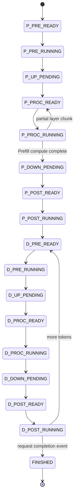

# Scheduler State Machine

The final compacted source uses obfuscated enum identifiers. This document maps them back to readable lifecycle states.

## 1. State mapping

| Compact state | Readable state | Interpretation |
|---|---|---|
| `Z15` | `P_PRE_READY` | Waiting for Edge Prefill pre-task |
| `Z36` | `P_PRE_RUNNING` | Prefill pre-task executing on Edge |
| `Z21` | `P_UP_PENDING` | Prefill UP transfer pending/in flight |
| `Z8` | `P_PROC_READY` | Ready for Prefill compute on assigned Cloud |
| `Z22` | `P_PROC_RUNNING` | Prefill compute executing |
| `Z51` | `P_DOWN_PENDING` | Prefill DOWN transfer pending/in flight |
| `Z27` | `P_POST_READY` | Ready for Edge Prefill post-task |
| `Z59` | `P_POST_RUNNING` | Prefill post-task executing |
| `Z9` | `D_PRE_READY` | Ready for next Decode pre-task |
| `Z52` | `D_PRE_RUNNING` | Decode pre-task executing on Edge |
| `Z20` | `D_UP_PENDING` | Decode UP transfer pending/in flight |
| `Z16` | `D_PROC_READY` | Ready for Decode compute on assigned Cloud |
| `Z75` | `D_PROC_RUNNING` | Decode compute executing |
| `Z53` | `D_DOWN_PENDING` | Decode DOWN transfer pending/in flight |
| `Z23` | `D_POST_READY` | Ready for Edge Decode post-task |
| `Z60` | `D_POST_RUNNING` | Decode post-task executing |
| `Z39` | `FINISHED` | Request is complete |

## 2. State transitions



## 3. Partial `P_PROC`

The NOVA scheduler can represent partial layer progress for Prefill compute. A `P_PROC` task may return to `P_PROC_READY` when only a chunk of layers has been executed.

However, experiments showed that aggressive splitting could be harmful. In particular, attempts to split Prefill compute on #3 were catastrophic, so the final policy only permits chunking when a utility calculation predicts enough completion benefit to justify the additional scheduling overhead.

## 4. Readiness bookkeeping

Each transition removes the request from its old ready queue and inserts it into the new state's queue when applicable. Pending transfer and running states are not represented in ready sets.

This invariant makes the scheduler's decision step simpler:

```text
ready sets = operations that are legally launchable now
```

while busy flags encode resources that cannot accept another launch.

## 5. Metric updates tied to transitions

Two metric boundaries are especially important:

- **TDR:** accumulated when `P_POST` finishes and the request moves to `D_PRE_READY`.
- **Token gap / TPOT contribution:** updated when `D_POST` finishes; the current time is compared with the request's previous Decode-post completion time.

Because metrics are attached to transitions, changing queue order can affect a metric only if it changes the corresponding completion timestamps. This observation helped explain several public no-op experiments.
