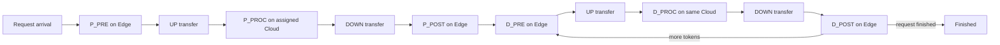

# System Model

## 1. High-level topology

The solver treats the workload as an online pipeline spanning one Edge execution resource, `K` Cloud execution resources, and two serialized communication directions.



The important structural constraints in the implementation are:

- **Edge is serial.** At most one Edge task is active at a time.
- **Each Cloud is serial.** Different clouds may execute simultaneously, but a single cloud executes one Cloud task at a time.
- **UP is serialized.** Transfers sent toward Cloud are modeled by one FIFO-like tail time.
- **DOWN is serialized.** Transfers returning toward Edge use a separate serialized tail.
- **Cloud assignment is persistent.** A request is assigned to a Cloud during its Prefill admission and Decode remains associated with that Cloud.
- **Task launch has scheduling overhead `S`.** Batching can amortize this overhead, but waiting to form large batches can hurt latency.

These properties are visible in the final scheduler's Edge busy flag, per-Cloud busy flags, independent `upTail`/`downTail` timing, and persistent request `remote/cloud` field.

## 2. Two workload phases

A request has two qualitatively different phases.

### Prefill

Prefill is a single pass through:

```text
P_PRE → UP → P_PROC → DOWN → P_POST
```

The public experiments showed that Prefill admission pressure can dominate the system. In particular, testcase #15 improved dramatically when unfinished Prefill chains were bounded rather than admitted without backpressure.

### Decode

After Prefill, Decode is iterative:

```text
D_PRE → UP → D_PROC → DOWN → D_POST
  ▲                                  │
  └──────────── next token ──────────┘
```

Decode introduces a batching/coherence problem: larger coherent waves amortize fixed task cost, while excessive waiting can increase token gaps or delay completion.

## 3. Compute-time curves

The input provides task-duration tables indexed by batch/request size. The final solver stores separate interpolated curves for:

- `P_PRE`
- `P_PROC`
- `P_POST`
- `D_PRE`
- `D_PROC`
- `D_POST`

The implementation linearly interpolates between supplied table points when an exact size is unavailable.

This matters because scheduling is not simply a queue-order problem: the duration of a batched operation depends on the number or size of requests scheduled together.

## 4. Communication model

For a transfer of `n` logical units, the implementation models communication time as a fixed latency plus serialization time:

```text
transfer_time = latency + 8 * n * bytes_per_token / (bandwidth * 1e6)
```

The exact logical unit passed to this function depends on the task family. UP and DOWN maintain separate future-tail timestamps, so scheduling a transfer reserves that link into the future.

A consequence is that transfer order can become effectively committed once work is enqueued. Several experiments therefore focused on *when* tasks were released to communication rather than attempting to reorder already-queued transfers.

## 5. Resource coupling

The resources are not independent.

A decision to start a Prefill task can:

1. occupy Edge,
2. enqueue an UP transfer,
3. create work for a particular Cloud,
4. enqueue a DOWN transfer,
5. later return to Edge for `P_POST`.

Similarly, a Decode wave creates synchronized pressure on Edge, Cloud, UP, and DOWN resources.

This coupling is why many local priority changes were public no-ops: changing one queue's order did not necessarily change the system's critical resource trajectory.

## 6. Batching versus responsiveness

The scheduler repeatedly balances two competing effects:

- **Coherence/batching:** fewer launches, better amortization of `S`, larger efficient Decode waves.
- **Responsiveness:** lower Prefill completion time, earlier Decode start, smaller token gaps.

The final architecture does not choose one globally. It uses specialist policies and, for the strongest #4 improvement, overlaps a coherent Decode cohort with residual Prefill work in otherwise idle resource slots.

## 7. Online/event-driven operation

The program does not build an offline full schedule. It receives events, updates state, then emits zero or more launch commands for currently idle resources.

Conceptually:

```text
receive events at time t
        ↓
mark completed tasks/transfers
        ↓
update ready queues and metrics
        ↓
choose work for idle Edge / Clouds
        ↓
emit commands
        ↓
wait for next event
```

This online nature is central to the experimental design: successful changes altered the *trajectory of future readiness* rather than merely optimizing a static ordering.
