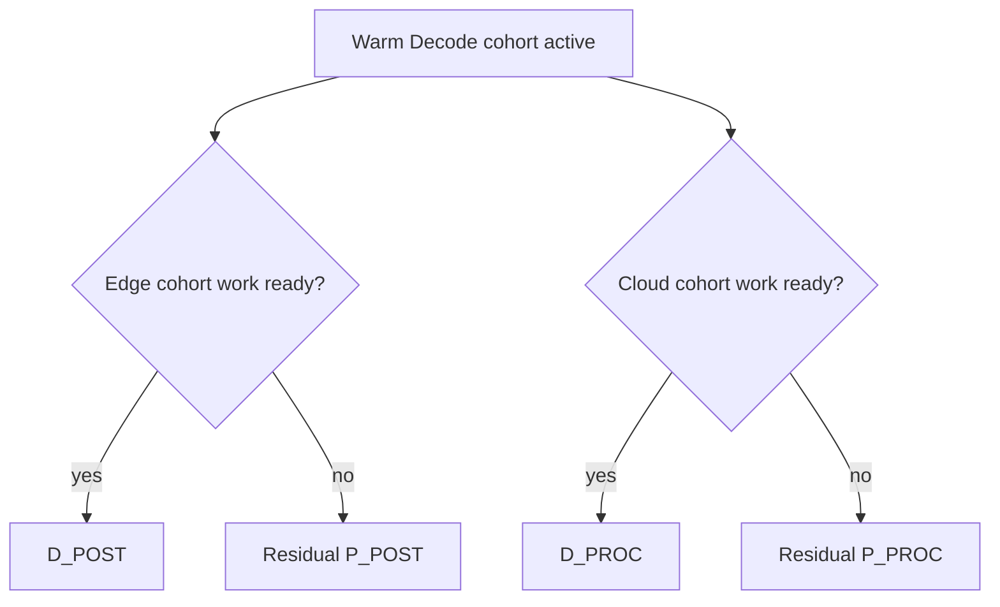

# Concurrent Warm Breakthrough

## 1. The architectural change

The non-concurrent warm scheduler gave Decode a coherent early wave, but residual Prefill could be unnecessarily blocked while that wave was active.

`CONCURRENT80` changed the phase semantics:

- The warm Decode cohort **kept priority**.
- If the Edge had no cohort D_POST ready, a residual **P_POST** could fill the hole.
- If a Cloud had no cohort D_PROC ready, residual **P_PROC** could fill the hole.

The scheduler therefore retained Decode coherence without reserving every resource exclusively for Decode.

## 2. CONCURRENT80: better throughput *and* better completion

The public comparison was unusually strong:

| Metric | WARM4 80% | CONCURRENT80 |
|---|---:|---:|
| #4 score | 811.420602 | **813.462929** |
| TP | 0.062664 | **0.062973** |
| mean TDR | 473.665006 | **465.245343** |
| mean TPOT | 85.580454 | **84.083242** |

This was not the usual throughput-vs-completion trade. Concurrency improved both sides relative to the non-concurrent 80% scheduler.

The TDR returning to **465.245343**—the same value as the 100% / original phase behavior—was particularly revealing. The early Decode wave no longer had to impose the same Prefill-completion penalty.

## 3. Why Edge-only and Cloud-only overlap were not enough

Archived local diagnostics isolated the two overlap mechanisms. Edge-only and Cloud-only variants were both worse than the combined V1 trajectory.

These are **local archived observations**, not public banked results, but they supported a useful interpretation:

> The gain came from coordinated two-resource overlap rather than one lucky fallback.

The public CONCURRENT80 result then validated the combined architecture.

## 4. Reopening the threshold search under the new architecture

Once Prefill could continue underneath the warm wave, thresholds that were too aggressive before became worth revisiting.

Public results:

| Concurrent readiness | #4 score | TP | mean TDR | mean TPOT |
|---:|---:|---:|---:|---:|
| 80% | 813.462929 | 0.062973 | 465.245343 | 84.083242 |
| 77.5% | 813.775135 | 0.063085 | 465.245343 | 83.894827 |
| 72.5% | 814.140250 | 0.063215 | 465.245343 | 83.567043 |
| 70% | **818.687390** | **0.065020** | 468.892661 | 86.877574 |
| **65%** | **819.020237** | **0.065139** | 468.892661 | **86.339424** |
| 60% | 809.014692 | 0.061553 | 468.598623 | 86.354695 |

### 70%: a second regime change

The jump from 72.5% to 70% was much larger than the preceding threshold refinements. Throughput rose from 0.063215 to 0.065020, producing a +4.547-point score jump on #4 relative to 72.5%.

This indicated another discrete scheduling regime rather than a smooth parameter curve.

### 65%: final public optimum among tested variants

At 65%:

- #4 reached **819.0202365952**;
- TP improved slightly again to **0.065139**;
- TDR remained identical to the 70% variant;
- TPOT improved from 86.877574 to **86.339424**.

The total bank became:

**16315.7938558663**

### 60%: the early-start cliff returns

At 60%, #4 fell to **809.0146923137**. The concurrency architecture had moved the safe boundary substantially earlier, but it had not eliminated the existence of a boundary.

The final policy therefore stopped at the best publicly verified point instead of extrapolating further.

## 5. The system-level interpretation

The strongest final interpretation is:

> The system benefits from beginning a coherent first Decode epoch well before Prefill is completely drained, provided the Decode epoch has priority but does not monopolize resources that it cannot currently use.

This combines three ideas that individually were insufficient:

1. **Coherence** — avoid fragmenting the Decode generation.
2. **Early start** — do not wait for a full Prefill barrier.
3. **Opportunistic overlap** — let residual Prefill consume Edge/Cloud holes under Decode priority.

That combination was the final #4 breakthrough.

## Evidence

- E041–E046 in [`../../experiments/data/experiment_ledger.csv`](../../experiments/data/experiment_ledger.csv)
- [`../../experiments/data/case4_threshold_curve.csv`](../../experiments/data/case4_threshold_curve.csv)
- [`../architecture/FINAL_CONCURRENT_WARM_PIPELINE.md`](../architecture/FINAL_CONCURRENT_WARM_PIPELINE.md)
- Curated sources in [`../../src/06_concurrent_warm/`](../../src/06_concurrent_warm/)
