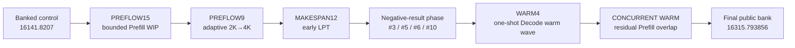

# Optimization Journey

This directory tells the engineering story of the scheduler: what was observed, what was hypothesized, which interventions were tried, what the public judge actually verified, and how those results changed the next experiment.

The narrative is intentionally evidence-first. Exact public results come from [`../../experiments/data/experiment_ledger.csv`](../../experiments/data/experiment_ledger.csv), [`../../experiments/data/score_progression.csv`](../../experiments/data/score_progression.csv), and the preserved 22-case vectors. Local-only findings are labeled as such, and approximate historical notes are not silently upgraded into exact results.

## Reading order

1. [`01_JOURNEY_OVERVIEW.md`](01_JOURNEY_OVERVIEW.md) — the full optimization arc and score progression.
2. [`02_PREFLOW_BREAKTHROUGHS.md`](02_PREFLOW_BREAKTHROUGHS.md) — bounded Prefill WIP on #15 and adaptive WIP on #9.
3. [`03_MAKESPAN_AND_CONTROL_SURFACES.md`](03_MAKESPAN_AND_CONTROL_SURFACES.md) — #12, early LPT, and how public no-ops exposed the live decision window.
4. [`04_DEAD_ENDS_AND_NEGATIVE_RESULTS.md`](04_DEAD_ENDS_AND_NEGATIVE_RESULTS.md) — #3, #5/#6, #10, and why failed experiments mattered.
5. [`05_WARM_PHASE_DISCOVERY.md`](05_WARM_PHASE_DISCOVERY.md) — the one-shot early Decode warm wave and the non-concurrent threshold cliff.
6. [`06_CONCURRENT_WARM_BREAKTHROUGH.md`](06_CONCURRENT_WARM_BREAKTHROUGH.md) — filling warm-epoch holes with residual Prefill and the path to the final 65% scheduler.
7. [`07_FINAL_ARCHITECTURE_AND_LESSONS.md`](07_FINAL_ARCHITECTURE_AND_LESSONS.md) — final system-level interpretation, submission discipline, and general lessons.

## High-level arc

## Evidence conventions

- **Public exact** — exact Codeforces public-judge value preserved in the experiment dataset.
- **Public approximate** — public result where only a historical rounded baseline was preserved.
- **Local archived** — reproduced or preserved local-interactor behavior; useful for hypothesis formation, not banking.
- **Engineering interpretation** — explanation inferred from controlled experiments and implementation behavior.

The detailed taxonomy is documented in [`../../experiments/DATA_DICTIONARY.md`](../../experiments/DATA_DICTIONARY.md).
